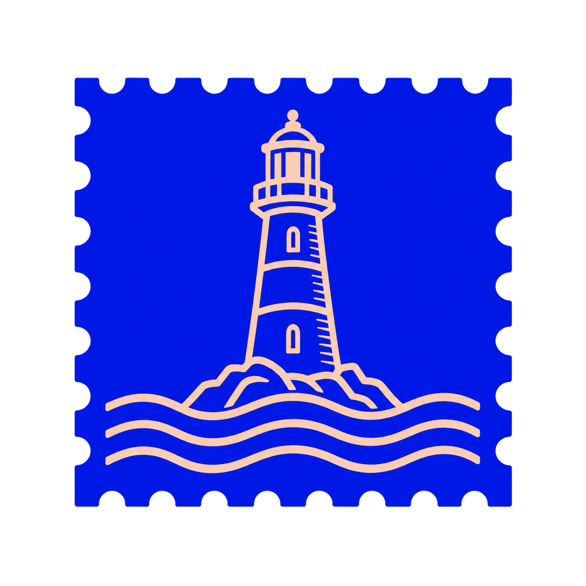
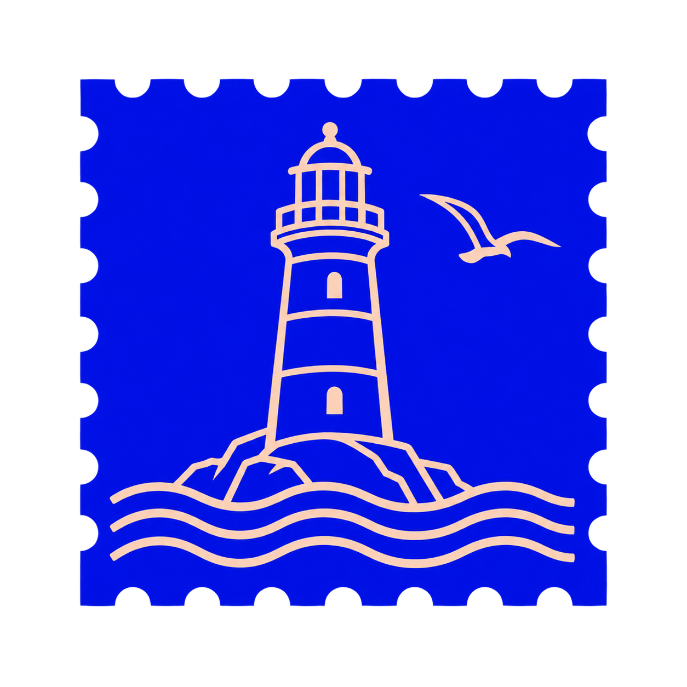
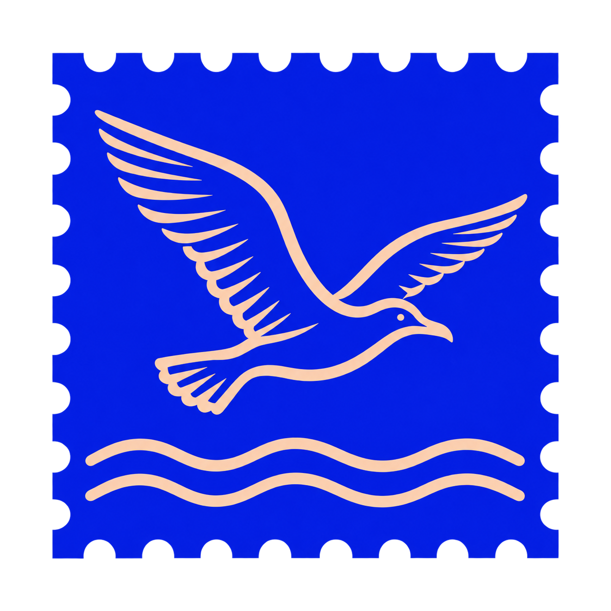

# Courrier — pistes de timbre

Trois compositions partagent le timbre perforé et le contraste cobalt–pêche. Les scènes varient pour comparer leur lisibilité et leur densité.

| Phare et vagues | Phare, vagues et mouette | Mouette et vagues — intégrée à l’app |
| --- | --- | --- |
|  |  |  |

La mouette et les vagues sont actuellement intégrées à l’app et à son animation de chargement. Les deux compositions avec phare restent ici comme pistes de test. Ces exports transparents sont les matériaux de base : le cobalt et les détails pêche restent dans le dessin, sans fond autour du timbre. Un fond de présentation pourra être ajouté séparément selon l’usage.

À 34 px, le phare avec vagues est le plus lisible ; la mouette reste identifiable avec les vagues ; la composition complète est la plus dense.
